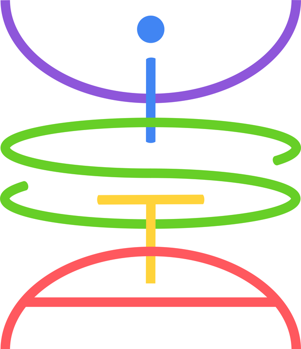

<p align="left">
  
</p>

# ViSta — Visibility Stacking

[](https://vista-hpc.readthedocs.io/en/latest/)
[](https://colab.research.google.com/github/martitors/ViSta-HPC/blob/extract_opt/examples/ViSta_tutorial.ipynb)
[](https://doi.org/10.1088/1538-3873/ae1faf)
[](https://doi.org/10.1117/12.3103792)

**ViSta** stacks interferometric observations of many faint sources in the
**visibility (uv) plane** and measures the stacked emission: line profile,
flux, width, size, continuum and significance. Each dataset can have its own
redshift, telescope, array configuration, spectral setup and phase centre:
ViSta re-centres it on its source, brings it to the rest frame and regrids it
onto a common grid, and measures the stack directly on the visibilities.

**Documentation: <https://vista-hpc.readthedocs.io>** — installation, every
step of the stacking, the measurement, the command line, a complete worked
example, the parameters and the API.

## Features

- **One pass over the data**: re-centring, rest-framing, regridding, continuum
  subtraction and compression while the stack is written
- **Fast**: reader processes, a GIL-free C++/OpenMP kernel (optional CUDA) and
  parallel writers; 15–30× faster than the CASA implementation on the same data
- **Measured in the uv plane**: one fit of all channels and baselines, with the
  noise measured from the data, the size of the source and the significance
- **Zarr or Measurement Set** output; `export_ms` for imaging tools
- Any telescope that writes **Measurement Sets** (ALMA, VLA, NOEMA, MeerKAT, ...)

## Installation

```bash
git clone https://github.com/martitors/ViSta-HPC.git
cd ViSta-HPC
pip install -r requirements.txt pybind11
cmake -S . -B build -DCMAKE_BUILD_TYPE=Release     # add -DWITH_CUDA=ON for the GPU
cmake --build build -j && cmake --install build
```

## Quick start

```bash
./run_vista.sh --input input_list.txt --output-name co32 --verbose \
               --line-freq 345.79599 --line-window 500 --velocity-range 900 --extract
```

or from Python:

```python
from vista import ViSta

v = ViSta("input_list.txt", output_name="co32")    # input, output, how it runs
v.stack(line_freq=345.79599, line_window=500, velocity_range=900)   # the line, the band, the continuum
v.extract(fwhm_range=(100, 600))                   # the measurement (skip it: only the stack)
v.help()                                           # every option: its value now, what it can be
result = v.run()
print(result)
```

with `input_list.txt` holding one dataset per line:
`<ms_path> <redshift> <RA> <Dec> [FIELD_ID] [SPW_IDS] [NORM]`. The redshifts
are taken in LSRK and the inputs are brought to it; add `--frame BARY`
(`v.stack(..., frame="BARY")`) if yours are barycentric. Several lines:
`v.stack(line_freq=[f1, f2], line_window=[w1, w2])`.

The [worked example](https://vista-hpc.readthedocs.io/en/latest/examples/index.html)
(`examples/ViSta_tutorial.ipynb`, runs on
[Google Colab](https://colab.research.google.com/github/martitors/ViSta-HPC/blob/extract_opt/examples/ViSta_tutorial.ipynb))
stacks simulated ALMA data and changes one option at a time, against the
true signal (`result.plot()`, `vista.compare`).

## Citation

> Torsello et al. (2025), *The ViSta method for stacking in the Fourier domain
> and its application to the dusty star-forming galaxies in the ALMA Science
> Archive*, PASP 137, 124501,
> [doi:10.1088/1538-3873/ae1faf](https://doi.org/10.1088/1538-3873/ae1faf)
>
> Torsello et al. (2026), *The ViSta method for optimized stacking of broadband
> interferometric data in the Fourier domain*, Proc. SPIE 14153, 141531X,
> [doi:10.1117/12.3103792](https://doi.org/10.1117/12.3103792)

```bibtex
@article{Torsello2025,
  author  = {Torsello, M. and Massardi, M. and Liuzzo, E. and
             Gururajan, G. and Perrotta, F. and Lapi, A.},
  title   = {The {ViSta} method for stacking in the {Fourier} domain and its
             application to the dusty star-forming galaxies in the {ALMA}
             Science Archive},
  journal = {Publ. Astron. Soc. Pac.},
  volume  = {137},
  number  = {12},
  pages   = {124501},
  year    = {2025},
  doi     = {10.1088/1538-3873/ae1faf}
}

@inproceedings{Torsello2026,
  author    = {Torsello, M. and Massardi, M. and Liuzzo, E. and
               Gururajan, G. and Perrotta, F. and Lapi, A.},
  title     = {The {ViSta} method for optimized stacking of broadband
               interferometric data in the {Fourier} domain},
  booktitle = {Radio Telescopes, Technologies, and Methods},
  series    = {Proc. SPIE},
  volume    = {14153},
  pages     = {141531X},
  year      = {2026},
  doi       = {10.1117/12.3103792}
}
```

## License

MIT. The changes of every version are in the
[changelog](https://vista-hpc.readthedocs.io/en/latest/reference/changelog.html).
